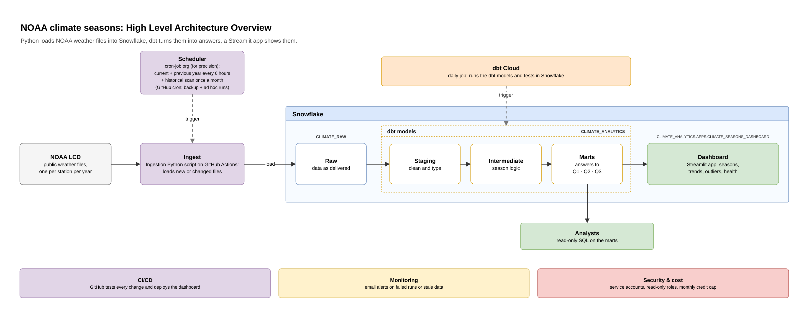

# NOAA Thermal Seasons

When does each season start, is that changing, and what outliers were recorded?
A data pipeline that loads NOAA weather data into **Snowflake**, transforms it with
**dbt**, and serves the answers in a **Streamlit** app inside Snowflake.



## The answers in brief

Twelve US weather stations, 2006 to today. Seasons are **thermal**: defined by each
station's own temperatures, not the calendar.

1. **When seasons start.** Summer starts in early to mid June, on nearly the same date
   everywhere. Autumn starts in early to mid September (late August in Miami), winter in
   the second half of November. Spring is the least regular: early February to early
   March, with frequent cold relapses.
2. **Change and trend.** **Autumn starts later at all 12 stations** (about +7 days per
   decade; strong evidence) and **summer earlier at 10 of 12** (about −2.6; moderate
   evidence), so the warm season is getting longer at 11 of 12 stations (median +11.6 days
   per decade). Spring probably starts earlier too, but the evidence is weak. Winter shows
   no trend. The directions hold under four different method settings; the strength of
   the evidence varies.
3. **Outliers.** 211 unusually warm or cold days (144 cold, 67 warm), and each station's
   record high and low. No doubtful or impossible measurements; one real
   data gap (Denver, 2013) was rebuilt from hourly readings and validated.

Full results: [docs/answers.md](docs/answers.md).

## Why 12 stations for the MVP

The brief is to design a process and answer three questions. The MVP (minimum viable
product) proves the whole process end to end on a sample chosen to cover the main US
climate types, before scaling it.

- **Covers the climates that matter.** One long-record airport weather station in each of NOAA's nine
  climate regions of the contiguous US, a second station in the two most varied regions
  (Southeast: Atlanta and Miami; Southwest: Denver and Phoenix), and Anchorage for Alaska:
  maritime, continental, desert, subtropical and subarctic climates are all represented.
- **Enough to answer the questions.** The evidence for a trend is agreement across
  different climates, and 12 stations already give a clear result (autumn later at
  12 of 12: about a 1-in-2,000 chance if there were no trend and stations were
  independent, which nearby stations are not fully). More stations would refine the
  numbers, not change the method.
- **Every result can be checked by hand.** About 250 station-years let us verify events
  against external records, investigate and rebuild the Denver 2013 gap, and review every
  flagged day. At 6,100 stations that review would need its own process.
- **Fast and cheap to iterate.** A full reload of 12 stations is quick on the smallest
  warehouse, so the method could be tested, changed and re-run many times (including the
  sensitivity check). All US stations over 20 years is over 1 TB of files, 97% of it
  hourly data the questions do not need, which calls for a different loading pattern.
- **Scaling is designed.** Adding a station is one line in
  `dbt/seeds/stations_of_interest.csv` plus one backfill run for its history; the
  pipeline does not change. The national
  path (NOAA inventory for change detection, yearly archives, object storage + Snowpipe,
  incremental models, a 100-station pilot first) is in
  [architecture.md](docs/architecture.md#scaling-up).

## Documents

| Document | Contents |
|---|---|
| [Answers](docs/answers.md) | results for Q1–Q3, with tables, evidence and caveats |
| [Methodology](docs/methodology.md) | definitions, choices and alternatives, trend and outlier methods, limitations, glossary |
| [Architecture](docs/architecture.md) | components, data flow, design decisions, reliability, security, cost, scaling |
| [Overview diagram](docs/architecture_overview.png) · [detailed diagram](docs/architecture_detailed.png) | editable `.drawio` sources next to them |

## How the brief is covered

| Requirement | Where |
|---|---|
| Load at least the last 5 years | about 21 years (2006 → today), any range by parameter |
| Pattern of season starts (Q1) | `mart_season_onset_trends`, dashboard tab *Season start* |
| Change and trend (Q2) | `mart_season_onset_trends`, `mart_season_trend_summary`, `mart_warm_season_length`, tab *Shift Trends* |
| Outliers (Q3) | `fct_weather_outliers`, tab *Outliers* |
| Snowflake | raw and analytics databases, alert, dashboard |
| dbt | all transformations, tests and documentation |
| Scalable to more history and future data | change detection, incremental loads, fixed baseline; national-scale design in [architecture](docs/architecture.md#scaling-up) |
| Architecture diagram, methodology, answers | [`docs/`](docs/) |

## Repository layout

| Path | Contents |
|---|---|
| `ingest/` | Python ingest (`ingest.py`): change detection, download, load, run log; offline tests |
| `.github/workflows/` | `ingest.yml` scheduled load · `ci.yml` lint and tests · `dashboard.yml` test and deploy |
| `snowflake/` | setup SQL, run once (order in [Running it](#running-it)) |
| `dbt/` | dbt project: `models/` (staging, intermediate, marts), `tests/`, `seeds/`, `macros/`, `analyses/` |
| `dashboard/` | Streamlit app, Snowflake CLI deploy definition, smoke tests |
| `docs/` | documents and diagrams |

## Running it

On a fresh Snowflake account, in this order. Run the setup scripts as `ACCOUNTADMIN`.
Each script says which key pair to generate and where its public part goes. Replace the
placeholders first: `<YOUR_USER>` (your Snowflake user name, `SELECT CURRENT_USER()`),
`<ALERT_EMAIL>` (a verified email of a user in the account) and the public keys.

**1. Snowflake, part 1**

| Script | Creates |
|---|---|
| `snowflake/01_setup.sql` | warehouse, databases, roles, stage, file format, raw tables, run log |
| `snowflake/02_service_user.sql` | `INGEST_SVC` (key pair) for the ingest |
| `snowflake/03_governance.sql`, sections 1 and 3 | `DBT_SVC`; one warehouse per workload; credit cap |

**2. GitHub secrets:** `SNOWFLAKE_ACCOUNT`, `SNOWFLAKE_USER` (`INGEST_SVC`),
`SNOWFLAKE_PRIVATE_KEY`, `SNOWFLAKE_DEPLOY_PRIVATE_KEY`.

**3. Load data.** Run the *ingest* workflow manually with `start_year = 2006` and
`load_station_list = true`, or locally:

```bash
pip install -r ingest/requirements.txt
export SNOWFLAKE_ACCOUNT=... SNOWFLAKE_USER=INGEST_SVC SNOWFLAKE_PRIVATE_KEY_PATH=... SNOWFLAKE_WAREHOUSE=LOAD_WH
python ingest/ingest.py --start-year 2006 --load-station-list
```

Scheduling: an external scheduler (cron-job.org) calls the workflow's `workflow_dispatch`
API every 6 hours; the workflow's own schedule is the backup (see the header of
`.github/workflows/ingest.yml`).

**4. dbt.** dbt Cloud project with subdirectory `dbt`; Production environment connected
as `DBT_SVC` (role `DBT_ROLE`, warehouse `TRANSFORM_WH`); one job:
`dbt source freshness` then `dbt build`, daily at 11:30 UTC. The first production build
creates the `MARTS` schema. Locally: `dbt deps && dbt build`.

**5. Snowflake, part 2** (needs the marts from step 4)

| Script | Creates |
|---|---|
| `snowflake/03_governance.sql`, section 2 | read-only `REPORTER_ROLE` on the marts |
| `snowflake/04_alerts.sql` | email integration and the staleness alert (every 3 hours) |
| `snowflake/05_dashboard.sql` | `APPS` schema, dashboard role, `DASHBOARD_DEPLOY_SVC` |

**6. Dashboard.** Deployed by `dashboard.yml` on every push to `main` that changes
`dashboard/` (or run the workflow manually the first time). Open it in Snowsight:
*Projects → Streamlit → CLIMATE_SEASONS_DASHBOARD*. The app shuts down after 1 day without
viewers to save cost, so the first visit after that takes about a minute.

## Tests

| Where | What |
|---|---|
| `ingest/tests` (pytest, CI) | change detection, header guard, station-list parser, run outcome, crashed runs still logged |
| `dashboard/tests` (pytest, CI on every pull request) | every dashboard tab renders for every season, with Snowflake mocked |
| dbt (every build) | source freshness, keys, raw → staging reconciliation, completeness, hourly-rebuild accuracy, data-quality rules, seasons in natural order, unit tests for the season-start rule |
| CI | ruff, actionlint, dbt parse |
