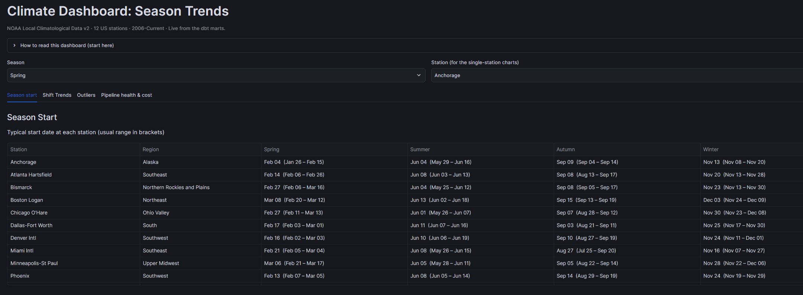
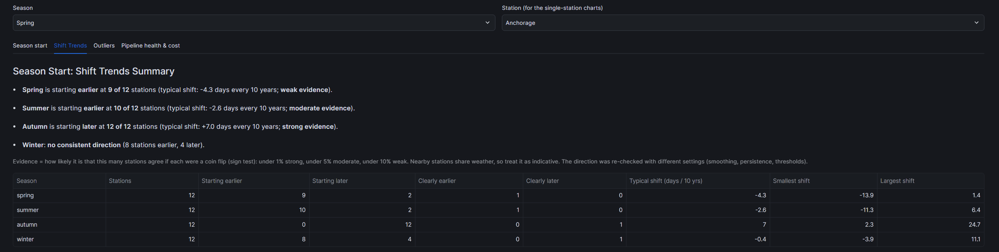
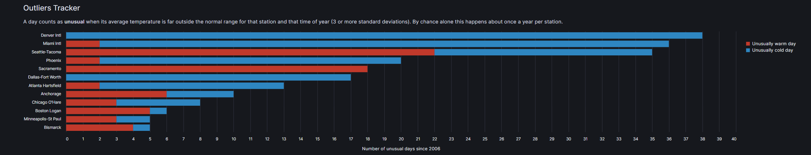

# Answers

Results for the three questions in the brief, from 12 US weather stations, 2006 to today
(about 21 years per station). How the numbers are produced is in
[methodology.md](methodology.md). Every figure can be regenerated with the queries listed in
[How to verify these numbers](#how-to-verify-these-numbers), and the tables are live in the
dashboard.

> **One idea to keep in mind:** seasons here are **thermal**, defined by each station's own
> temperatures, not by the calendar. "Spring starts" means the 7-day average temperature
> leaves the station's coldest quarter of the year and stays out for 5 days. That is why
> spring "starts" in February: it is the end of the coldest stretch, not the first warm day.

## Short answers

| Question | Answer |
|---|---|
| **Q1. When does each season start?** | **Summer** starts in early to mid June, on nearly the same date everywhere. **Autumn** starts in early to mid September (late August in Miami), **winter** in the second half of November. **Spring** is the least regular: early February to early March, with a wide spread between years and frequent cold relapses after it starts. |
| **Q2. Has it changed? Is there a trend?** | **Autumn: yes, clearly.** It starts later at all 12 stations (about +7 days per decade). **Summer: probably** (moderate evidence): earlier at 10 of 12 (about −2.6 days per decade). **Spring: probably, but the evidence is weak:** earlier at 9 of 12, by an amount that depends on the method settings. **Winter: no trend.** Together, the warm season (summer → autumn) is getting longer at 11 of 12 stations (median +11.6 days per decade). |
| **Q3. What outliers were recorded?** | Two kinds, kept apart. **Climate outliers** (real but extreme weather): 211 days far outside the normal range for their date, cold extremes about twice as common as warm ones, plus each station's record high and low. **Data-quality outliers** (doubtful measurements): no values flagged by NOAA and no physically impossible values; the one real data problem was a 9-month gap in Denver's daily summaries in 2013, rebuilt from hourly readings. |

### The dashboard

The answers are also live in a Streamlit dashboard inside Snowflake. It runs in the
project's Snowflake account, so here is what it shows:

---

## Q1. What is the pattern for when each season starts?

Typical start date (median over about 21 years), with the middle half of the years in brackets.

| Station | Region | Spring | Summer | Autumn | Winter |
|---|---|---|---|---|---|
| Anchorage | Alaska | Feb 04 (Jan 26 – Feb 15) | Jun 04 (May 29 – Jun 16) | Sep 09 (Sep 04 – Sep 14) | Nov 13 (Nov 08 – Nov 20) |
| Atlanta Hartsfield | Southeast | Feb 14 (Feb 06 – Feb 26) | Jun 08 (Jun 03 – Jun 13) | Sep 08 (Aug 13 – Sep 17) | Nov 20 (Nov 13 – Nov 28) |
| Bismarck | Northern Rockies & Plains | Feb 27 (Feb 06 – Mar 16) | Jun 04 (May 25 – Jun 12) | Sep 08 (Sep 05 – Sep 17) | Nov 23 (Nov 13 – Nov 30) |
| Boston Logan | Northeast | Mar 08 (Feb 20 – Mar 12) | Jun 13 (Jun 02 – Jun 18) | Sep 15 (Sep 13 – Sep 19) | Dec 03 (Nov 24 – Dec 09) |
| Chicago O'Hare | Ohio Valley | Feb 27 (Feb 11 – Mar 13) | Jun 01 (May 26 – Jun 07) | Sep 07 (Aug 28 – Sep 12) | Nov 30 (Nov 23 – Dec 08) |
| Dallas-Fort Worth | South | Feb 17 (Feb 03 – Mar 01) | Jun 11 (Jun 07 – Jun 16) | Sep 03 (Aug 21 – Sep 11) | Nov 25 (Nov 17 – Nov 30) |
| Denver Intl | Southwest | Feb 16 (Feb 02 – Mar 03) | Jun 10 (Jun 06 – Jun 19) | Sep 10 (Aug 27 – Sep 19) | Nov 24 (Nov 11 – Dec 01) |
| Miami Intl | Southeast | Feb 21 (Feb 05 – Mar 04) | Jun 08 (May 26 – Jun 15) | Aug 27 (Jul 25 – Sep 20) | Nov 16 (Nov 07 – Nov 27) |
| Minneapolis-St Paul | Upper Midwest | Mar 06 (Feb 21 – Mar 17) | Jun 05 (May 28 – Jun 11) | Sep 05 (Aug 22 – Sep 14) | Nov 28 (Nov 22 – Dec 06) |
| Phoenix | Southwest | Feb 13 (Feb 07 – Mar 05) | Jun 08 (Jun 05 – Jun 14) | Sep 14 (Aug 29 – Sep 19) | Nov 24 (Nov 19 – Nov 29) |
| Sacramento | West | Feb 06 (Jan 27 – Feb 22) | Jun 05 (May 31 – Jun 17) | Sep 02 (Jul 26 – Sep 19) | Nov 24 (Nov 15 – Dec 02) |
| Seattle-Tacoma | Northwest | Feb 15 (Jan 29 – Mar 03) | Jun 02 (May 16 – Jun 24) | Sep 17 (Sep 14 – Sep 23) | Nov 21 (Nov 13 – Nov 25) |

**Patterns**

- **Summer starts on nearly the same date everywhere:** the typical start falls between
  June 1 and June 13 at all 12 stations. Year to year, summer and winter are the most
  regular seasons: the middle half of the years spans 9 to 21 days at every station,
  except Seattle's summer (39 days, with its variable early summers).
- **Spring is the least regular.** Typical dates run from Feb 4 (Anchorage) to Mar 8
  (Boston), and the middle half of the years spans up to five weeks at a single station
  (Bismarck: Feb 6 to Mar 16). Spring also **relapses**: in 10 to 18 of 21 years per
  station, the 7-day average falls back into the cold quarter within 30 days of the start.
  When it does, it spends 10 to 15 of those 30 days there on average (most in Anchorage;
  least in Minneapolis, which also relapses least often, in 10 of 21 years). Spring's
  start is best read as *the first sustained warm-up*.
- **Autumn** clusters in early to mid September. Miami and Sacramento are the
  exceptions: their warm season fades gradually, so the start varies most and can
  come as early as late July.
- **Winter** starts in the second half of November almost everywhere; maritime Boston
  is latest (early December), Anchorage earliest (mid November).
- Because each station is measured against its own climate, very different places
  (Phoenix, Minneapolis, Miami) have similar calendars. The dates say *when the local
  year turns*, not how hot or cold it gets.

---

## Q2. Has the start of each season changed, and is there a trend?

**Headline:** **autumn is arriving later** (strong evidence) and **summer earlier**
(moderate evidence), so the warm part of the year is stretching at both ends. Spring also
tends to start earlier, but the evidence is weak. Winter shows no trend.

### Agreement across the 12 stations

A single station over 21 years is noisy: weather swings from year to year are much larger
than any trend. The strongest evidence is many stations moving the same way.

| Season | Earlier / later (stations) | Clear trend at a single station¹ | Typical shift (days per decade) | Range across 4 method settings² | Chance of this agreement if there were no trend³ | Verdict |
|---|---|---|---|---|---|---|
| Spring | 9 / 2 (1 flat) | 1 earlier | **−4.3** | −3.6 to −9.8 (8–12 stations earlier) | 6.5% | Probably earlier; weak evidence |
| Summer | 10 / 2 | 1 earlier | **−2.6** | −1.8 to −2.6 (9–10 earlier) | 3.9% | Earlier; moderate evidence |
| Autumn | 0 / 12 | 1 later | **+7.0** | +5.2 to +8.3 (11–12 later) | 0.05% | **Later; strong evidence** |
| Winter | 8 / 4 | 1 later | −0.4 | direction flips (4–8 earlier) | 39% | No trend |

¹ |t| ≥ 2.1 (about p < 0.05 with ~20 years). With 48 station-season tests, 2 to 3 "clear"
results are expected by chance alone, so single-station results are not the evidence.
² Sensitivity check ([`onset_sensitivity.sql`](../dbt/analyses/onset_sensitivity.sql)):
persistence 5 vs 10 days, smoothing 7 vs 14 days, thresholds p25/p75 vs p20/p80.
³ Two-sided sign test: if each station were equally likely to move either way, the chance
that at least this many agree is 2 × P(X ≥ k), with X ~ Binomial(n, ½) and ties excluded
(e.g. autumn: 12 of 12 → 2 × ½¹² ≈ 0.05%). Verdicts: under 1% strong, under 5% moderate,
under 10% weak evidence. Nearby stations share weather, so they are not
fully independent; read these as indicative, not exact. Under the other method settings
the agreement is weaker for spring (8 of 12 with p20/p80 thresholds, ≈39%) and summer
(9 of 12 with 14-day smoothing, ≈15%), and unchanged in direction for autumn.

### Per station (days per decade; negative = earlier; **bold** = clear trend at that station)

| Station | Spring | Summer | Autumn | Winter |
|---|---|---|---|---|
| Anchorage | +0.8 | −1.0 | +2.3 | +0.8 |
| Atlanta Hartsfield | **−13.9** | −0.8 | +11.2 | **+8.9** |
| Bismarck | −5.7 | **−8.9** | +10.2 | −3.9 |
| Boston Logan | −0.7 | +0.9 | +4.5 | +1.5 |
| Chicago O'Hare | −4.3 | −2.5 | +12.1 | −2.0 |
| Dallas-Fort Worth | −4.4 | +6.4 | +5.2 | −2.3 |
| Denver Intl | 0.0 | −0.5 | +5.2 | −2.0 |
| Miami Intl | −9.7 | −11.3 | **+24.7** | +11.1 |
| Minneapolis-St Paul | −7.0 | −2.8 | +8.3 | −0.1 |
| Phoenix | −2.7 | −3.5 | +9.1 | −0.4 |
| Sacramento | −4.7 | −3.3 | +5.7 | −3.5 |
| Seattle-Tacoma | +1.4 | −8.9 | +4.5 | −0.5 |

### The warm season is getting longer

Summer starts earlier at 10 of 12 stations and autumn starts later at all 12, so the
warm season (from the start of summer to the start of autumn, typically 84 to 107 days)
is getting **longer at 11 of 12 stations**, by a median of **+11.6 days per decade**.
The change is clear on its own at three stations: Miami (+36), Bismarck (+19) and
Phoenix (+13 days per decade). Dallas-Fort Worth is the only station where it shortens
slightly (−1.2). Per-station values:
[`q2_warm_season_length.sql`](../dbt/analyses/answers/q2_warm_season_length.sql).

### What this does and does not show

- **Shows:** a consistent shift in when the warm part of the year begins and ends,
  across very different US climates. For autumn it survives every change to the method;
  for summer and spring the direction holds but the strength of evidence varies.
- **Does not show:** a cause, or a long-term climate trend. Twenty-one years is short
  (climate normals use 30), and the start and end years can move a slope.

---

## Q3. What outliers have been recorded?

Outliers are split into two families on purpose, because they need opposite responses:
a doubtful measurement should be **excluded**; extreme but real weather is a **finding**.

### Climate outliers: real weather, far from normal

A day is **unusual** when its average temperature is 3 or more standard deviations away from
that station's normal for that time of year (normal = 2006–2020 average within ±15 days of
the date). By chance alone this happens about once a year per station.

- **211 unusual days** across the 12 stations: **144 unusually cold** and **67 unusually
  warm**. The rule is designed to flag the rarest days (roughly one per station per year,
  about 250 over this period), so the count itself is not the finding. What matters is
  where they fall and in which direction. Cold extremes are about twice as common,
  consistent with winter cold-air outbreaks departing further from normal than warm
  spells do. Cold extremes concentrate in Denver (38 days), Miami (34), Phoenix (18) and
  Dallas-Fort Worth (17); warm extremes in Seattle (22) and Sacramento (18).

- **Verified events:**
  - **Denver, December 2008:** a low of −18 °F (−27.8 °C) on 14 December, matching our
    recorded minimum for that day exactly, followed by −19 °F on the 15th, among the
    coldest December days on record in Denver.
  - **Bismarck, January 2009:** a record low of −44 °F on 15 January, followed by a sharp
    warm-up. Our "sudden jump" on 16 January is that rebound, not an error.

**Records** are each station's hottest and coldest day in the period loaded (2006 → today,
official daily values only). They are records *for this period*, not all-time records.
There are 23 record-high and 16 record-low days for 12 stations because of ties: NOAA
values come from whole °F, so the same record can be reached on several days (Phoenix's
record high, for example, on 5 days).

| Station | Record high | Record low |
|---|---|---|
| Anchorage | 32.2 °C · 4 Jul 2019 | −31.1 °C · 7 Jan 2009 |
| Atlanta Hartsfield | 41.1 °C · 30 Jun 2012 | −14.3 °C · 7 Jan 2014 |
| Bismarck | 44.4 °C · 30 Jul 2006 | −42.2 °C · 15 Jan 2009 |
| Boston Logan | 39.4 °C · 22 Jul 2011 | −23.2 °C · 4 Feb 2023 |
| Chicago O'Hare | 39.4 °C · 5–6 Jul 2012 | −30.5 °C · 30 Jan 2019 |
| Dallas-Fort Worth | 43.3 °C · 2 Aug 2011; 25–26 Aug and 8 Sep 2023 | −18.8 °C · 16 Feb 2021 |
| Denver Intl | 40.6 °C · 25–26 Jun 2012; 28 Jun 2018 | −31.0 °C · 22 Dec 2022 |
| Miami Intl | 37.8 °C · 18 Aug 2026 | 1.7 °C · 10 Jan 2010; 1 Feb 2026 |
| Minneapolis-St Paul | 39.4 °C · 7 Jun 2011 | −33.2 °C · 30 Jan 2019 |
| Phoenix | 48.3 °C · 29 Jun 2013; 20 Jun 2017; 19, 20 and 25 Jul 2023 | −1.7 °C · 14–15 Jan 2007; 15 Jan 2013 |
| Sacramento | 45.6 °C · 5–6 Sep 2022 | −6.1 °C · 15 Jan 2007 |
| Seattle-Tacoma | 42.2 °C · 28 Jun 2021 | −10.0 °C · 20 Dec 2008; 24 Nov 2010 |

**Checked against news reports.** These record dates match reported events, and each of
our values rounds to the reported whole °F:

- **Seattle-Tacoma**, 108 °F on 28 Jun 2021: the station's all-time record, during the
  Pacific Northwest heat dome ([FOX 13](https://www.fox13seattle.com/weather/two-year-anniversary-of-seattles-hottest-day-on-record)).
- **Dallas-Fort Worth**, −2 °F on 16 Feb 2021, during the February 2021 winter storm
  ([NWS Fort Worth](https://weather.gov/fwd/Feb-2021-WinterEvent)).
- **Chicago O'Hare**, −23 °F on 30 Jan 2019, the coldest in Chicago in 34 years
  ([CBS Chicago](https://www.cbsnews.com/amp/chicago/news/chicago-deep-freeze-extreme-cold-wind-chill-warning-temperature-records)).
  Minneapolis-St Paul's record low is the same day.
- **Anchorage**, 90 °F on 4 Jul 2019, 5 °F above the city's previous record
  ([Fox News](https://www.foxnews.com/us/alaskas-largest-city-sees-record-90-degrees-other-cities-hit-all-time-highs)).
- **Atlanta**, 106 °F on 30 Jun 2012, a new all-time record
  ([AccessWDUN](https://accesswdun.com/print/2012/6/250244)).
- **Denver**, −24 °F on 22 Dec 2022
  ([9NEWS](https://9news.com/article/weather/weather-colorado/denver-record-cold-2022/73-61ef19e7-f4cc-445c-a092-1018f35cccc1)).
- **Boston**, −10 °F on 4 Feb 2023
  ([Boston Globe](https://www.bostonglobe.com/2023/02/04/metro/record-low-temperatures-across-state-thousands-without-power)).
- **Phoenix**, 119 °F on 19 Jul 2023, the first time since 20 Jun 2017, which is also one
  of its record days here ([ABC15](https://www.abc15.com/news/local-news/phoenix-hits-119%C2%BA-for-first-time-in-6-years)).
- **Miami**, 100 °F on 18 Aug 2026, only the second 100 °F day in Miami's records, after
  1942 ([WLRN](https://www.wlrn.org/2026-08-18/miami-officially-hit-100-f-second-time-in-recorded-history)).
  Its record low, 35 °F on 1 Feb 2026, ties January 2010, in line with reports of the
  coldest temperatures since 2010 ([Infobae](https://www.infobae.com/estados-unidos/2026/02/01/una-ola-de-frio-artico-afecta-a-miami-beach-la-ciudad-amanecio-con-las-temperaturas-mas-bajas-desde-2010/)).

**The most unusual days for their date** (largest z-scores):

| Date | Station | Daily average | z-score |
|---|---|---|---|
| 17 Aug 2013 | Atlanta Hartsfield | 17.5 °C | −4.6 |
| 14 Dec 2010 | Miami Intl | 7.0 °C | −4.5 |
| 27 Jun 2021 | Seattle-Tacoma | 31.4 °C | +4.5 |
| 19 Mar 2019 | Seattle-Tacoma | 20.6 °C | +4.5 |
| 17 Jul 2013 | Miami Intl | 23.9 °C | −4.3 |

Ten of the 15 most unusual days are cold, but not all are winter outbreaks: six are cool
summer days in warm climates, where summer temperatures normally vary little, so one cool
day stands far outside the normal range. The top one is Atlanta's 16–17 August 2013, when a
wedge of cold air gave record-low daytime highs of 67 °F and 66 °F
([UGA Field Report](https://fieldreport.caes.uga.edu/news/august-rounds-out-this-cool-wet-georgia-summer/)).
Three of Seattle's five are the June 2021 heat dome. The full list of 15 is in
[`q3_records_and_extremes.csv`](evidence/results/q3_records_and_extremes.csv).

### Data-quality outliers: can the measurement be trusted?

Every day is checked automatically on every run.

| Check | Result | Action |
|---|---|---|
| Value flagged by NOAA as suspect or wrong | 0 days | would be removed from all calculations |
| Physically impossible or contradictory values (e.g. max below min) | 0 days | would be removed; the daily build warns |
| Same mean, max and min 5 days in a row ("stuck sensor") | 1 day (Miami, 14 April 2015) | review only: daily mean, max and min were identical for 10–14 April, but the hourly readings kept varying: real, very stable weather, not a stuck sensor |
| Day-to-day change over 20 °C | 2 days (Denver, Bismarck) | review only: real weather, a Denver cold front (Dec 2008) and the Bismarck rebound after its record low (Jan 2009) |
| **Missing daily summaries** | **Denver, April–December 2013** | **rebuilt from hourly readings** |

**The Denver 2013 gap** is the one real data problem found. NOAA's daily summaries for
Denver are blank from April to December 2013 (and October's rows are missing), while the
hourly sensor kept reporting. We rebuilt those **274 days** as the midpoint of the hourly
maximum and minimum, only when at least 18 hours were reported. Tested on **90,509 days**
that have both values, the rebuild is off by **0.24 °C on average** (bias −0.07 °C) and
within 1 °C **99.2%** of the time. A plain average of the hourly readings has about three
times the error (0.66 °C). Rebuilt days are labelled, checked on every build, and never used for
records. The cause of the gap is unknown; it is not the October 2013 US government
shutdown, because the gap starts in April.

---

## How to verify these numbers

| Figure | Query | Result (27 Oct 2026) |
|---|---|---|
| Q1 table | [`q1_typical_onsets.sql`](../dbt/analyses/answers/q1_typical_onsets.sql) | [q1_typical_onsets.csv](evidence/results/q1_typical_onsets.csv) |
| Q2 headline table | [`q2_summary.sql`](../dbt/analyses/answers/q2_summary.sql) | — |
| Q2 per station | [`q2_station_trends.sql`](../dbt/analyses/answers/q2_station_trends.sql) | [q2_station_trends.csv](evidence/results/q2_station_trends.csv) |
| Warm-season length | [`q2_warm_season_length.sql`](../dbt/analyses/answers/q2_warm_season_length.sql) | [q2_warm_season_length.csv](evidence/results/q2_warm_season_length.csv) |
| Sensitivity ranges | [`onset_sensitivity.sql`](../dbt/analyses/onset_sensitivity.sql) | — |
| Sign-test percentages | computed from the Q2 headline counts (formula in footnote ³) | — |
| Spring relapses | [`spring_relapses.sql`](../dbt/analyses/spring_relapses.sql) | [spring_relapses.csv](evidence/results/spring_relapses.csv) |
| Q3 counts | [`q3_outlier_counts.sql`](../dbt/analyses/answers/q3_outlier_counts.sql) | — |
| Q3 records and extremes | [`q3_records_and_extremes.sql`](../dbt/analyses/answers/q3_records_and_extremes.sql) | [q3_records_and_extremes.csv](evidence/results/q3_records_and_extremes.csv) |
| Hourly-rebuild accuracy | [`hourly_rebuild_validation.sql`](../dbt/analyses/hourly_rebuild_validation.sql) | [hourly_rebuild_validation.csv](evidence/results/hourly_rebuild_validation.csv) |
