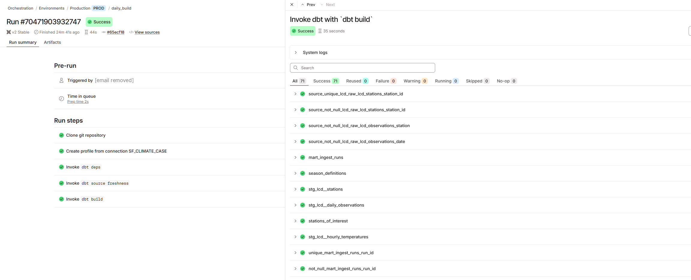

# Evidence

The dbt project runs in dbt Cloud, which reviewers cannot open. This folder is a dated
snapshot of a production run and of the query outputs behind the answers. Ingest runs, CI
and dashboard deploys are visible in the repository's **Actions** tab.

## Production build, 27 October 2026

- dbt Cloud job `daily_build` (Production environment) at commit `65ecf18`:
  `dbt source freshness`, then `dbt build`.
- **71 of 71 passed, no warnings:** 16 models, 52 data tests, 2 seeds, 1 unit test.
- [Run log](dbt_build_2026-10-27.log) (colour codes removed) ·
  [screenshot](dbt_build_2026-10-27.png) (the triggering user's email is masked).

## Query results

Outputs of the queries behind [answers.md](../answers.md), run in dbt Cloud against the
production marts on 27 October 2026. Each file is the unedited export of its query.

| Result | Query | Used in |
|---|---|---|
| [q1_typical_onsets.csv](results/q1_typical_onsets.csv) | [`q1_typical_onsets.sql`](../../dbt/analyses/answers/q1_typical_onsets.sql) | Q1 table |
| [q2_station_trends.csv](results/q2_station_trends.csv) | [`q2_station_trends.sql`](../../dbt/analyses/answers/q2_station_trends.sql) | Q2 per station |
| [q2_warm_season_length.csv](results/q2_warm_season_length.csv) | [`q2_warm_season_length.sql`](../../dbt/analyses/answers/q2_warm_season_length.sql) | warm-season length |
| [spring_relapses.csv](results/spring_relapses.csv) | [`spring_relapses.sql`](../../dbt/analyses/spring_relapses.sql) | Q1 spring relapses |
| [q3_records_and_extremes.csv](results/q3_records_and_extremes.csv) | [`q3_records_and_extremes.sql`](../../dbt/analyses/answers/q3_records_and_extremes.sql) | Q3 records and most unusual days |
| [hourly_rebuild_validation.csv](results/hourly_rebuild_validation.csv) | [`hourly_rebuild_validation.sql`](../../dbt/analyses/hourly_rebuild_validation.sql) | Denver 2013 rebuild accuracy |

`hourly_rebuild_validation.csv` lists stations by ID; names are in
[`stations_of_interest.csv`](../../dbt/seeds/stations_of_interest.csv).
